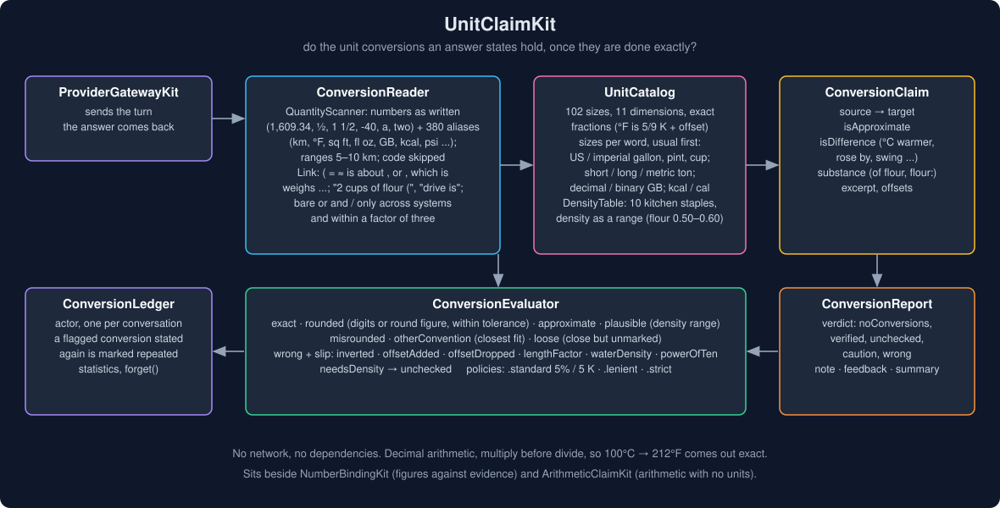
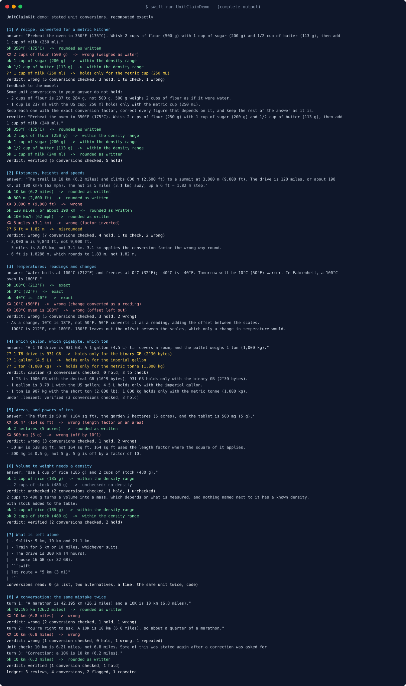
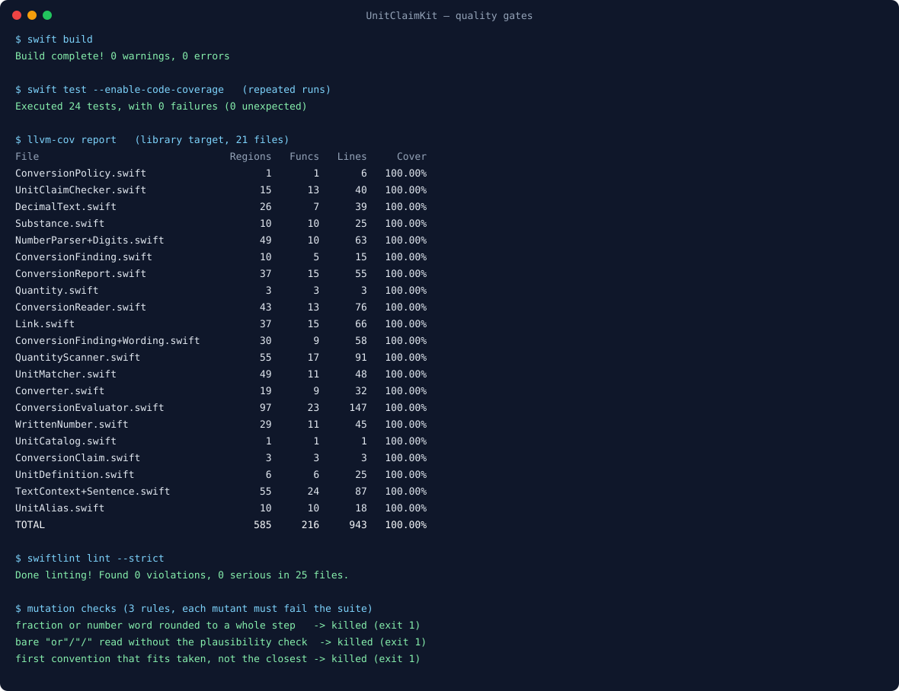

# UnitClaimKit



Someone asks for a recipe in grams and the answer says "2 cups of flour (500 g)". Someone else asks how
far a 5-mile walk is and hears "5 miles (3.1 km)". A forecast says it will be "10°C (50°F) warmer", and a
spec sheet calls a 1 TB drive "931 GB".

Each of those is a conversion the model did itself, in prose, with no tool and no source to check against.
The first weighs flour as if it were water (two cups are about 240 to 280 g). The second divides where it
should multiply (5 miles is 8.05 km). The third converts a temperature *change* as if it were a reading
(a 10°C rise is 18°F). The fourth is right only if a gigabyte means 2^30 bytes.

Unit mistakes are a known weak spot. NUMCoT (arXiv 2406.02864) found that errors with units of measurement
mostly come from getting the size relationship between units wrong, and that chain-of-thought reduces them
without removing them. A study of medical calculations (arXiv 2509.16584) lists the same kinds of slip:
a value used without converting it, a factor applied with the wrong size or in the wrong direction, and a
unit label misread. In an answer, a wrong conversion reads exactly like a right one.

UnitClaimKit reads the conversions an answer states, recomputes them exactly, and says which hold, which
are close or depend on a convention, and which are wrong, with the right value and, where it can tell,
the mistake behind it.

## Why

`NumberBindingKit` already checks figures against evidence, converting units when a figure should have come
from a tool result or a source. `ArithmeticClaimKit` recomputes arithmetic an answer works out on its own,
but treats units as text: `12 kg + 3 kg = 15 kg` is checked as numbers. Nothing in this ecosystem checked a
conversion the answer made with nothing to bind it to.

The hard part is not the factor table. It is reading conversions the way people write them, and knowing
when a value that looks wrong is in fact right:

- `350°F (175°C)` and `1 mile (1,600 m)` are rounded on purpose. A whole number ending in zeros, or in 5,
  may stand for a round figure, so long as it stays within the policy's tolerance.
- `1 gallon (4.5 L)` is wrong for a US gallon and right for an imperial one. `1 ton (1,000 kg)` is right
  only for a metric tonne. These are not errors, and they are not fine either: they are reported as
  holding only with the other convention, so the reader can see which one the answer assumed.
- `2 cups of flour (250 g)` needs a density, and a density is a range: a cup of flour weighs about 120 g
  spooned and more scooped.
- `2 cups or 3 tbsp` and `5 km or 10 miles` are alternatives, not conversions. `5 km or 3.1 miles` is a
  conversion.

## What it gives you

- **`ConversionReader`** finds stated conversions outside fenced and inline code: `Q (Q)`, `Q (about Q)`,
  `Q (Q / Q)`, `Q = Q`, `Q ≈ Q`, `Q is about Q`, `Q, or roughly Q`, `Q, which is Q`, `Q converts to Q`,
  `Q weighs Q`, chains (`1 inch = 2.54 cm = 25.4 mm`), ranges (`5–10 km (3–6 miles)`), and up to four words
  between a quantity and its link (`2 cups of flour (500 g)`, `a 1 TB drive is 931 GB`). A bare `or` or `/`
  counts only between metric and customary units and within a factor of three.
- **Numbers as written**: `1,609.34`, `.5`, `-40`, `1/2`, `½`, `1 ½`, `1 1/2`, and number words before a
  spelled-out unit (`a mile`, `two cups`). `24/7` and dates are not fractions.
- **380 aliases for 102 unit sizes** in 11 dimensions (length, area, volume, mass, temperature, time, speed,
  data, energy, pressure, power). Symbols are matched exactly (`MB` is not `Mb`, `cal` is not `Cal`), words in
  any case. Sizes are exact fractions of a base unit plus an offset, so `°F` is 5/9 of a kelvin and
  `100°C` converts to exactly `212°F`.
- **Conventions.** Where one word has several sizes, the usual one comes first and the rest are kept: US and
  imperial gallons, quarts, pints, fluid ounces and cups (plus the 240 mL US legal cup and the 250 mL metric
  cup), US and metric spoons, short, long and metric tons, decimal and binary kilo-, mega-, giga- and
  terabytes, food and small calories, mechanical and metric horsepower.
- **Temperatures as readings or changes.** "Warmer", "rose", "by", "a swing of" and similar words near a
  temperature make it a change, which converts without the offset between the scales.
- **`DensityTable`**: ten kitchen staples with density ranges (water, milk, flour, sugar, brown sugar, butter,
  honey, oil, rice, salt), found from the words between the quantity and its link or within three words of
  the claim. Add your own with `adding(_:)`.
- **`ConversionEvaluator`** recomputes in `Decimal` against the precision the value was written with.
- **`ConversionReport`**: a verdict (`noConversions`, `verified`, `unchecked`, `caution`, `wrong`),
  `corrections` with the right values, a `note` for the reader, a `feedback` message for the model, and a
  `summary` for a trace.
- **`ConversionLedger`** (actor): one per conversation. A flagged conversion stated again after a correction
  was asked for is marked `isRepeated`.
- **`ConversionPolicy`**: `.standard` (round figures and approximations within 5%, 5 K for temperatures;
  misrounding and other conventions reported), `.lenient` (10%, 8 K; both let through), `.strict` (a value
  must round to its own digits).

## Usage

```swift
import UnitClaimKit

let ledger = ConversionLedger()                    // one per conversation
let report = await ledger.review(answerText)

switch report.verdict {
case .wrong, .caution:
    showUnderTheAnswer(report.note)                // "Unit check: 5 miles is 8.05 km, not 3.1 km. ..."
    if report.repeatedCount == 0, let feedback = report.feedback {
        askForARewrite(feedback)                   // "Redo each one with the exact conversion factor, ..."
    }
case .verified, .unchecked, .noConversions:
    log(report.summary)                            // "5 conversions checked, 4 hold, 1 unchecked"
}
```

Without a conversation, `UnitClaimChecker(policy:densities:).check(text)` returns the same report.

## How a conversion is judged

| The exact value, against the value as written | Outcome | Severity |
| --- | --- | --- |
| equal | `exact` | holds |
| rounds to its digits, or to the round figure it is (`1,600`, `175`) within tolerance | `rounded` | holds |
| marked `≈`/`about`/`~`, or written as a fraction or word, within tolerance | `approximate` | holds |
| inside the range a substance's density allows | `plausible` | holds |
| a volume and a mass with no known substance | `needsDensity` | unchecked |
| within one step of its last digit, rounded the wrong way | `misrounded(correct:)` | caution (`.lenient`: holds) |
| holds only for another size of the unit (the closest such fit) | `otherConvention(used:instead:)` | caution (`.lenient`: holds) |
| within tolerance, but neither rounded nor marked approximate | `loose(correct:)` | caution |
| anything else | `wrong(correct:slip:)` | wrong |

A wrong value is matched against known mistakes, and the first that fits is named: `inverted` (the factor
applied the wrong way round), `offsetAdded` (a temperature change converted as a reading), `offsetDropped`
(a reading converted without the offset), `lengthFactor` (an area or volume converted with the length
factor), `waterDensity` (weighed as if it were water), `powerOfTen(n)` (off by a factor of ten or more).

## Where it sits

- **ProviderGatewayKit** sends the turn; this package checks the answer that comes back.
- **NumberBindingKit** binds figures to evidence; this one checks the conversions the answer made itself.
- **ArithmeticClaimKit** recomputes unitless arithmetic; **CalendarClaimKit** does dates.
- **OutputRepairKit** runs a bounded repair loop; `report.feedback` is the re-prompt.
- **ai-chat-app** runs it as the `unitCheck` stage after the model answers.

## Demo

`swift run UnitClaimDemo` runs eight scenarios with no network and prints 102 lines
([`Screenshots/demo-output.txt`](Screenshots/demo-output.txt)). Two of them:

```text
[1] A recipe, converted for a metric kitchen
    answer: "Preheat the oven to 350°F (175°C). Whisk 2 cups of flour (500 g) with 1 cup of sugar (200 g) and 1/2 cup of butter (113 g), then add 1 cup of milk (250 ml)."
    ok 350°F (175°C)  ->  rounded as written
    XX 2 cups of flour (500 g)  ->  wrong (weighed as water)
    ok 1 cup of sugar (200 g)  ->  within the density range
    ok 1/2 cup of butter (113 g)  ->  within the density range
    ?? 1 cup of milk (250 ml)  ->  holds only for the metric cup (250 mL)
    verdict: wrong (5 conversions checked, 3 hold, 1 to check, 1 wrong)
    feedback to the model:
      Some unit conversions in your answer do not hold:
      - 2 cups of flour is 237 to 284 g, not 500 g. 500 g weighs 2 cups of flour as if it were water.
      - 1 cup is 237 ml with the US cup; 250 ml holds only with the metric cup (250 mL).
      Redo each one with the exact conversion factor, correct every figure that depends on it, and keep the rest of the answer as it is.

[3] Temperatures: readings and changes
    answer: "Water boils at 100°C (212°F) and freezes at 0°C (32°F); -40°C is -40°F. Tomorrow will be 10°C (50°F) warmer. In Fahrenheit, a 100°C oven is 180°F."
    ok 100°C (212°F)  ->  exact
    ok 0°C (32°F)  ->  exact
    ok -40°C is -40°F  ->  exact
    XX 10°C (50°F)  ->  wrong (change converted as a reading)
    XX 100°C oven is 180°F  ->  wrong (offset left out)
    verdict: wrong (5 conversions checked, 3 hold, 2 wrong)
```

The others: distances and speeds (an inverted factor, a misrounded height), which gallon, gigabyte and ton
(and the same answer under `.lenient`), areas and powers of ten, a volume-to-weight conversion with no known
density (and then with one added to the table), what is left alone, and a ledger that marks the same wrong
conversion stated twice.



## Install

```swift
.package(url: "https://github.com/rajatslakhina/unit-claim-kit.git", from: "1.0.0")
```

Swift tools 6.0, Swift 6 language mode. macOS 13, iOS 16, tvOS 16, watchOS 9. No dependencies.

## Quality gates

All run on this machine (Swift 6.4.2, SwiftLint 0.63.2), and again on a fresh clone of this repository
after it was pushed:

- `swift build`: 0 warnings, 0 errors (clean build).
- `swift test --enable-code-coverage`: 24 tests, 0 failures, green on repeated runs.
- `llvm-cov report`: **100.00%** regions (585), functions (216) and lines (943) on all 21 library files
  ([`Screenshots/coverage.txt`](Screenshots/coverage.txt)).
- `swiftlint lint --strict`: 0 violations in 25 files, no suppressions.
- Three rules were mutation-checked in a copy, and each mutant fails the suite: letting a fraction or number
  word round to a whole step (so `1 L (1/4 gallon)` passes); reading a bare "or" without the plausibility
  check (so `5 km or 10 miles` is flagged); taking the first convention that fits instead of the closest
  (so `1 cup of water (250 g)` names the 240 mL cup).
- Probing with real answer shapes before 1.0.0 found five gaps, each fixed and pinned by a test:
  `2 cups of flour (500 g)` and `a 1 TB drive is 931 GB` were not read (words between the quantity and its
  link); a convention search took the first fit (`1 ton (1,000 kg)` named the long ton); a sentence's other
  ingredient stood in for an unknown one (`2 cups of stock` weighed as rice); `1/4 gallon` was rounded to a
  whole gallon; `24/7` was read as a fraction.



## Limits, stated plainly

- **Only stated conversions.** A value is checked against another quantity the answer gives for it. A lone
  "the trail is 6 miles" is not checked: there is nothing to compare it with.
- **Words between quantities are limited.** Up to four words may name what is measured. "A 10 km run, which
  for an American is 6.2 miles" is not read.
- **Densities are ranges for ten kitchen staples.** Anything else measured by volume and weighed is reported
  as unchecked, not guessed. Add substances for your domain.
- **No compound conversions.** `60 km/h` to `mph` is a unit of its own; `60 km in 1 hour` is not combined.
  Rates of data (`MB/s`, `Mbps`), currencies, and months or years (their lengths vary) are not converted.
- **A bare `K` is not kelvin** and a bare `t` is not a tonne, because both mean other things after a number
  (`5K run`, `3t`). Write `kelvin` or `tonne`.
- **Temperature changes need a word nearby** ("warmer", "rose", "by", "a swing of"). Without one, a
  temperature is a reading.
- **Prose, not code.** Fenced and inline code is skipped.

## License

MIT. See [LICENSE](LICENSE).
